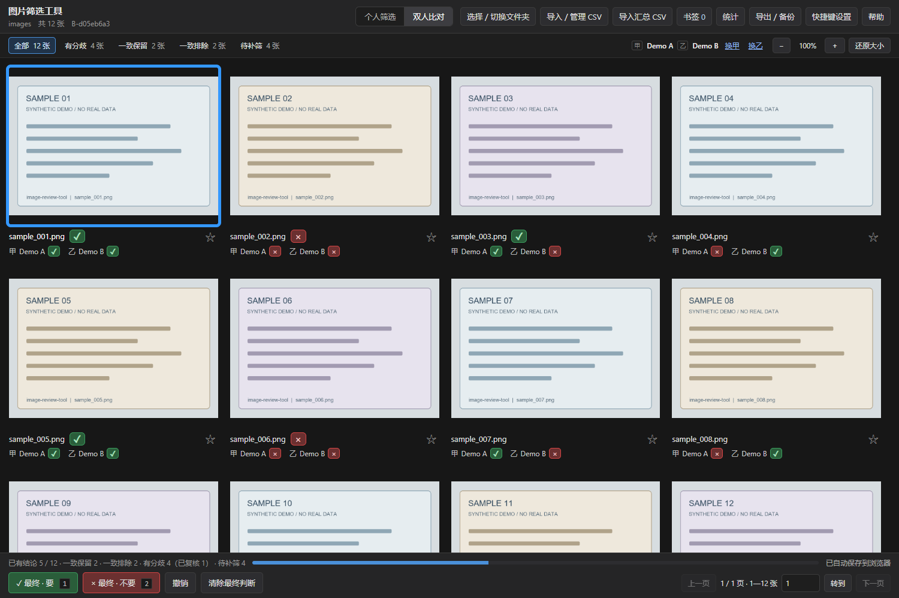

# 图片筛选工具

在浏览器里快速筛选本地图片，也可以导入两个人的 CSV，自动统计一致和分歧，再由第三人复核。

项目仓库：[dev230817-blip/image-review-tool](https://github.com/dev230817-blip/image-review-tool)。



## 直接开始

1. 下载并解压整个文件夹。
2. 用桌面版 Edge 或 Chrome 打开 `筛选工具.html`。
3. 点“选择／切换文件夹”，选中图片文件夹。
4. 当前图片有粗蓝框，按 `1` 保留、按 `2` 排除，自动选中下一张。

直接打开 HTML 无需安装 Python。图片从本机读取，筛选记录自动保存在当前浏览器中；定期通过“导出／备份”保存个人 CSV 或完整 JSON。

## 个人筛选与双人比对

| 模式 | 用途 |
| --- | --- |
| 个人筛选 | 各自标记 Yes／No，填写自己的名字或代号，导出个人 CSV |
| 双人比对 | 读入两份结果，自动统计一致、分歧和待补筛，再写入第三人的最终判断 |

两个人各自筛选后，把个人 CSV 交给第三人。第三人也需要有同一批图片，然后：

1. 打开图片文件夹，切到“双人比对”。
2. 点“导入／管理 CSV”，分别选择甲、乙的个人 CSV；两份一起选也可以。
3. 检查筛选人和图片清单，通过后点“开始比对”。
4. 在顶部横向分类中点击“有分歧”，按 `1／2` 给出最终判断。
5. 导出完整汇总 CSV；这份文件也可以再次导入，接着复核。

第一份 CSV 可以先暂存，再补第二份；已开始比对后，可单独替换其中一人的 CSV。两人的原始判断和第三人的复核分别保存。

## 功能

- 每行固定四张，每页最多 1000 张；Ctrl＋滚轮统一缩放，支持还原。
- 粗蓝框标识当前图片；Yes／No、自动下一张、撤销、清除判断、大图预览。
- 多个书签、可编辑备注、跨页定位；书签栏覆盖在图片上，不挤动网格。
- 两人的判断显示在图片名下面，最终结果显示在文件名旁。
- 全部、有分歧、一致保留、一致排除、待补筛，横向显示张数。
- 筛选人身份、图片清单与内容采样校验；兼容没有身份信息的旧 CSV。
- 完整汇总、分歧清单、最终 Yes／No 清单和完整 JSON 备份。

## 试用示例

本包附有 12 张完全虚构的图像和两份个人 CSV：

1. 选择 `examples/images` 作为图片文件夹。
2. 切到“双人比对”，分别导入 `examples/reviewer-a.csv` 和 `examples/reviewer-b.csv`。
3. 点“开始比对”。应看到一致保留 2 张、一致排除 2 张、有分歧 4 张、待补筛 4 张。

示例说明见 [examples/README.md](examples/README.md)。

## 可选：用 Python 同时保存到本地文件

如果希望除了浏览器保存，还自动写入本地 CSV 和会话文件，安装 Python 后双击 `启动筛图工具.cmd`，输入图片目录，也可以把图片文件夹拖到启动脚本上。

Python 脚本只使用标准库，无需安装额外包。建议使用 Python 3.10 或更新版本；本次打包使用 Python 3.13 验证。

```powershell
python .\筛选工具.py "D:\图片文件夹"
python .\筛选工具.py "D:\图片文件夹" --category IL
python .\筛选工具.py --merge "甲.csv" "乙.csv" --out "合并结果.csv"
```

启动脚本会检查 Python 启动器、常见 Conda 安装和 `python` 命令。自定义安装可先设置 `IMAGE_REVIEW_PYTHON` 为 Python 可执行文件路径。

## 保存和匹配

浏览器记录属于当前电脑和浏览器个人资料，不会自动同步到另一台电脑。跨电脑继续时，先打开相同图片目录，再导入个人 CSV、完整汇总 CSV 或完整 JSON 备份。

图片按相对路径匹配，图片目录内部结构需要一致。新 CSV 带有路径与大小组成的批次指纹，以及“文件大小＋首尾各 32KB”的内容采样校验。采样校验用来发现常见的同名不同图，不是逐字节全文件校验。

修改、增减或重命名图片可能改变批次。工具记录判断，不移动或删除原图。

## 文件入口

- [使用说明](使用说明.md)：完整操作、快捷键、恢复与 CSV 交接。
- [GitHub 上传说明](GitHub上传说明.md)：网页上传、仓库根目录、下载和版本发布。
- [更新记录](CHANGELOG.md)：本次发布包范围。
- [验证记录](docs/验证记录.md)：功能和打包检查。
- `SHA256SUMS.txt`：发布包文件校验清单。
